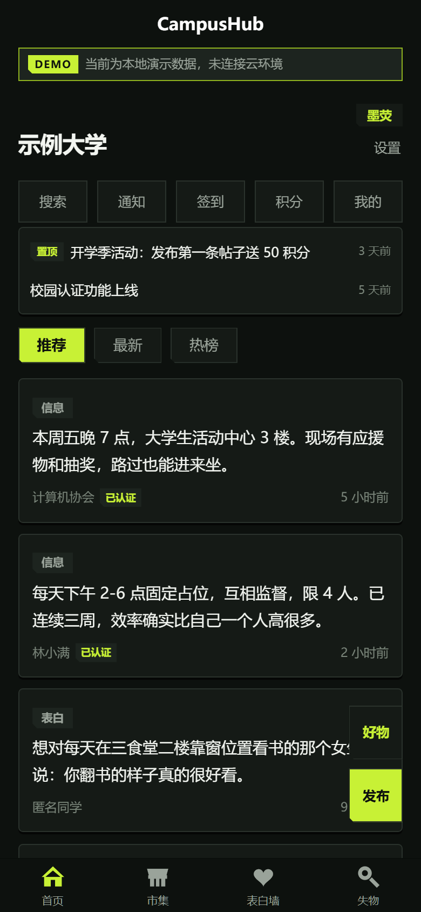
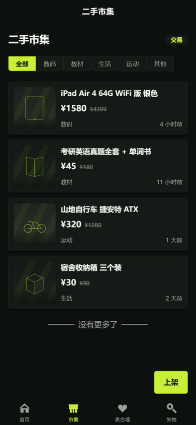
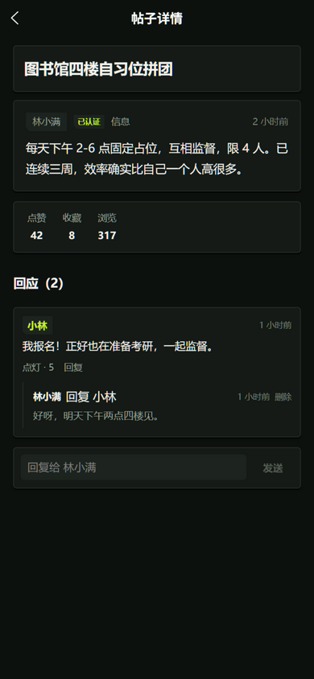
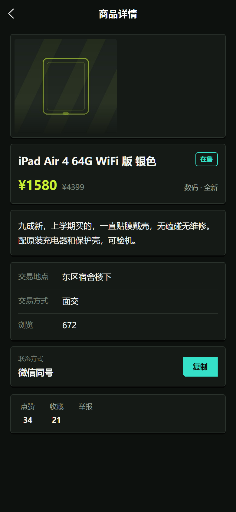
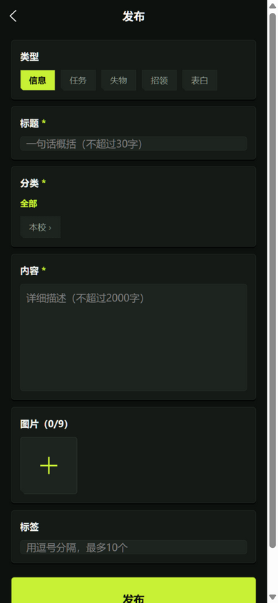
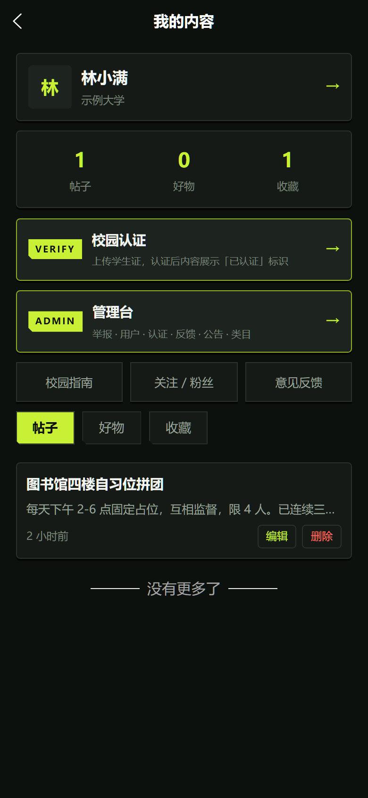
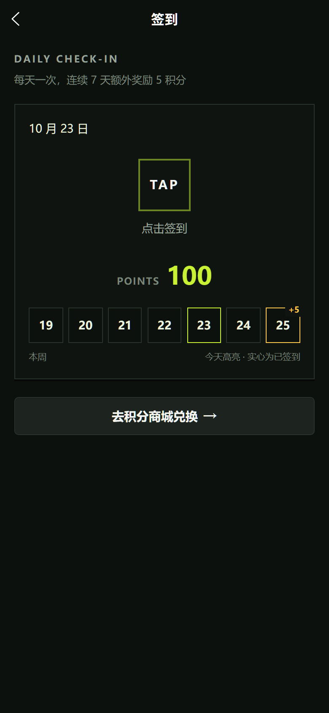
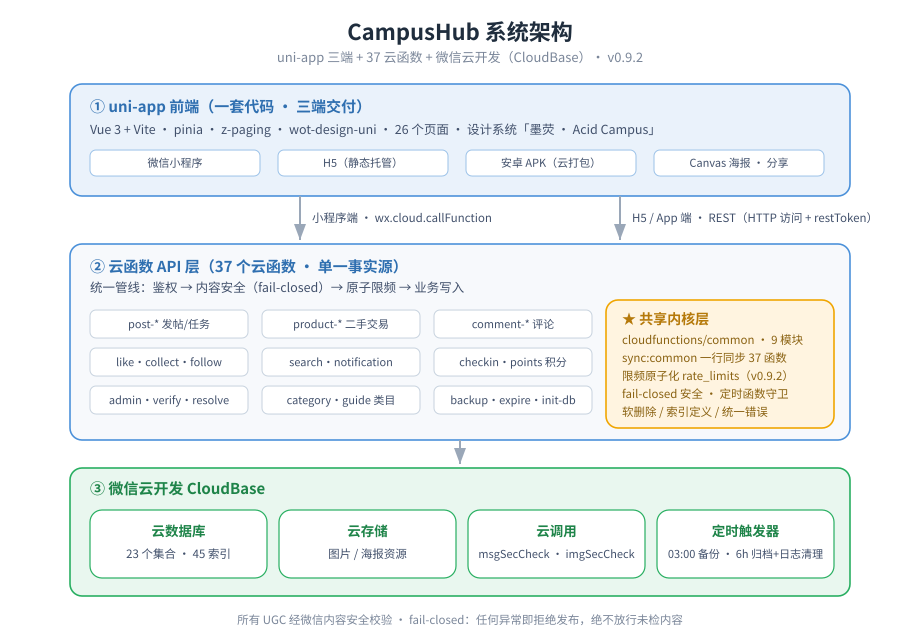
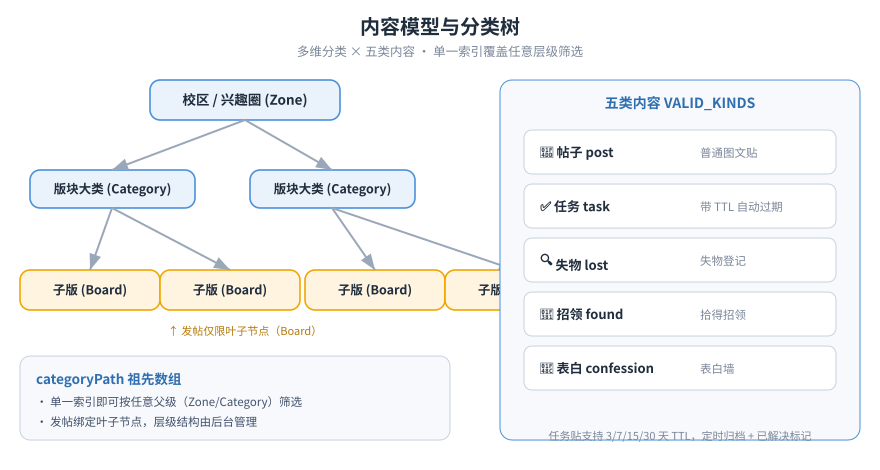

<p align="center"></p>

# CampusHub

> **An open-source campus content community, delivered to three platforms from one codebase — WeChat Mini Program / H5 / Android, powered by uni-app + Tencent CloudBase.**
> Multi-level categories, posts, second-hand market, threaded comments, check-in streaks, follows, content moderation, and an admin console — ready out of the box, near-zero cost.

<p align="center">
  <a href="./LICENSE"></a>
  <a href="./CHANGELOG.md"></a>
  <a href="https://uniapp.dcloud.net.cn/"></a>
  <a href="https://developers.weixin.qq.com/miniprogram/dev/wxcloud/basis/getting-started.html"></a>
  <a href="https://gitcode.com/badhope/campushub"></a>
  <a href="./CONTRIBUTING.md"></a>
</p>

<p align="center">
  📖 <a href="./docs/USER_GUIDE.md">使用说明书</a> ｜
  🚀 <a href="./docs/DEPLOY.md">部署上线指南</a> ｜
  📱 <a href="./docs/DEPLOY_H5_ANDROID.md">H5 / 安卓部署</a> ｜
  ✅ <a href="./docs/LAUNCH_CHECKLIST.md">上线检查清单</a> ｜
  🔍 <a href="./docs/AUDIT_REPORT_2026-10-22.md">全维度审查报告</a> ｜
  💰 <a href="./docs/COST.md">成本方案</a> ｜
  ⚖️ <a href="./docs/COMPLIANCE.md">合规要点</a> ｜
  🇨🇳 <a href="./docs/README.zh-CN.md">中文文档</a> ｜
  🌐 <a href="./index.html">Landing Page</a>
</p>

> If this project helps you, please give it a ⭐ **Star** on <a href="https://gitcode.com/badhope/campushub">GitCode</a> so more campuses can find it. Issues and PRs are welcome.

---

## 📸 Screenshots / 截图

> 以下 24 张为当前「墨荧 · Acid Campus」深色设计的**真实运行截图**（H5 构建产物、390×844 实机渲染、逐页实测无溢出/无报错）。

<p align="center">
  
  
  
  
  
</p>
<p align="center">
  
  
  
  
  
</p>

<p align="center">
  <a href="./docs/screenshots/overview-v1.png"><b>查看 24 页总览长图</b></a> ｜
  <a href="./docs/screenshots/v1/">逐页查看</a>
</p>

| 页面 | 文件 | 页面 | 文件 |
|---|---|---|---|
| 首页 | `v1/index.png` | 通知 | `v1/notification.png` |
| 二手市集 | `v1/market.png` | 搜索 | `v1/search.png` |
| 表白墙 | `v1/wall.png` | 关注 | `v1/follow.png` |
| 失物招领 | `v1/lost-found.png` | 签到 | `v1/checkin.png` |
| 帖子详情 | `v1/post-detail.png` | 积分商城 | `v1/points.png` |
| 商品详情 | `v1/product-detail.png` | 反馈 | `v1/feedback.png` |
| 发布 | `v1/post-create.png` | 举报 | `v1/report.png` |
| 发布好物 | `v1/product-create.png` | 校园认证 | `v1/verify.png` |
| 我的内容 | `v1/my-list.png` | 管理台 | `v1/admin.png` |
| 个人主页 | `v1/user-profile.png` | 公告管理 | `v1/announcements.png` |
| 编辑资料 | `v1/user-update.png` | 类目管理 | `v1/categories.png` |
| 校园指南 | `v1/guide-list.png` | 指南详情 | `v1/guide-detail.png` |
| 设置 | `v1/settings.png` | 用户协议 | `v1/legal-agreement.png` |
| 隐私政策 | `v1/legal-privacy.png` | | |

> ⚠️ `docs/screenshots/` 根目录的旧图（`index.png` / `profile.png` / `overview.png` 等）与 `docs/preview.html` 是 v0.8.1 白蓝主题历史版本，**不代表当前界面**。

## 🎯 Overview / 项目简介

CampusHub 是一个基于 **uni-app 三端（微信小程序 / H5 / 安卓 APK）+ 微信云开发（CloudBase）** 的开源校园内容社区。采用「**一校一部署**」模式：每个学校/组织独立部署一套云环境，学生在多层级分类树下发帖、提问、交易、互动。

| 核心能力 | 说明 |
|---|---|
| **一套代码 · 三端交付** | uni-app（Vue 3 + Vite）：微信小程序、H5、安卓 APK 共用 26 个页面与全部业务逻辑 |
| **多级分类** | Zone（校区/兴趣圈）→ Category（版块大类）→ Board（子版），后台 UI 即可调整，无需改代码 |
| **多元内容** | 帖子、任务、失物、招领、表白、二手商品、校园指南等 7 类内容 |
| **完整闭环** | 发帖 → 评论 → 点赞收藏 → 关注 → 通知 → 管理审核，覆盖社区全链路 |
| **安全优先** | 所有 UGC 经微信 `msgSecCheck` / `imgSecCheck`，**fail-closed**：任何异常即拒绝发布 |
| **近零成本** | 云开发免费额度起步，生产环境 19.9 元/月起 |



### 为谁而建？

| 👤 角色 | 典型场景 | 关键页面 |
|---|---|---|
| 普通学生 | 刷帖、找二手、看指南、评论互动 | 首页 / 帖子详情 / 搜索 |
| 卖家 | 发布闲置、管理在售、标记已售 | 发布商品 / 我的发布 / 商品详情 |
| 买家 | 搜索商品、联系卖家、收藏比价 | 二手市场 / 商品详情 / 通知 |
| 失主 / 拾主 | 发布失物或招领信息 | 发帖（失物/招领）|
| 管理员 | 审核举报、置顶公告、用户管理 | 审核台 / 校园认证 / 反馈 |

---

## 🏗️ Architecture / 系统架构

系统由 **uni-app 三端前端 → 云函数 API 层 → 微信云开发后端** 三层构成：

- **前端**：uni-app（Vue 3 + Vite），26 个页面，pinia 状态管理 + z-paging 分页 + wot-design-uni 组件，设计系统「墨荧 · Acid Campus」；微信小程序端走 `wx.cloud.callFunction`，H5 / App 端走 REST（CloudBase HTTP 访问服务 + restToken），同一套 37 个业务入口复用（部署在 10 个云函数上）
- **API 层**：37 个业务入口收敛为 **7 个资源型网关**（auth / post / product / comment / social / admin / content）+ 3 个独立函数（2 个定时器 + init-db）；入口按 `event.fn` 分发，鉴权/限频/审核仍在各入口内部执行。寻址表见 `gateway-routes.json`，说明见 [docs/GATEWAYS.md](docs/GATEWAYS.md)
- **共享内核**：`cloudfunctions/common/` 下 11 个模块（context / identity / scope / security / rate / db / content / indexes / error / bundle / subscribe）只保留一份源码，由 `build:functions`（esbuild）在构建期内联进每个函数产物 —— 部署物永远等于当前源码，副本漂移在结构上不可能（详见 [docs/SYNC.md](docs/SYNC.md)）
- **后端**：CloudBase 云数据库（23 集合 / 46 索引）、云存储、云调用（内容安全）、定时触发器（03:00 自动备份 · 6h 任务归档 + 日志清理）
- **v0.9.2 加固**：限频原子化（`rate_limits` 确定性 _id 占位 + 原子自增，杜绝并发绕过）、读侧查询白名单（`sanitizeQuery`）、定时函数管理员守卫（fail-closed）

---

## 🧩 Data Model / 内容模型



- **分类树 3 级**：`Zone → Category → Board`，后台可直接增删改，运营动作无需发版
- **`categoryPath` 祖先数组**：任一节点都保存从根到自身的路径 ID，**单一索引即可按任意父级筛选**，同时强制发帖必须选择叶子节点 `Board`
- **内容类型 `VALID_KINDS`**：`post` 帖子、`task` 任务、`lost` 失物、`found` 招领、`confession` 表白墙；任务帖支持 3/7/15/30 天 TTL 自动归档；二手商品为独立 `products` 集合（类目/成色/交易方式枚举白名单）

---

## ✨ Features / 核心特性

| 特性 | 描述 |
|---|---|
| 📱 **三端交付** | 微信小程序 / H5 / 安卓 APK 一套代码；HBuilderX 云打包出 APK |
| 🌳 **多级分类** | Zone → Category → Board（3 级）；`categoryPath` 祖先数组支持任意层级筛选；发帖限定叶子节点 |
| 🏠 **Feed 首页** | 双列瀑布流（帖子 + 商品）；推荐 / 热门 / 最新 Tab；分类筛选；过期归档入口 |
| 📝 **富文本帖子** | 图文混排、分类、标签、匿名发帖、图片预览；编辑模式回填（帖子和商品均支持） |
| ⏳ **任务与过期** | 任务帖支持 3/7/15/30 天 TTL；6 小时 cron 自动归档过期任务；作者/管理员可标记「已解决」|
| 🛒 **二手市场** | 商品列表、价格/成色/交易方式枚举白名单、联系信息、标记已售/重新上架、编辑商品 |
| 💬 **嵌套评论** | 楼层 + 子回复（replyCount 原子回退）、评论点赞、@ 回复 |
| 👥 **关注系统** | 关注/取关、粉丝/关注数、个人主页 |
| 📅 **每日签到** | 连续签到 + 积分 + 每周奖励（北京时间唯一索引防双签） |
| 🔔 **站内通知** | 点赞、评论、关注自动生成通知 |
| 📚 **校园指南** | 新生指南、学习攻略等文章，支持分类筛选 |
| 🔍 **搜索** | 跨集合搜索（帖子 / 商品 / 指南），标题 + 正文匹配，热词聚合最近 7 天 |
| 👤 **用户主页** | 公开资料、最近发布、关注按钮（他人视角脱敏） |
| 🛡️ **内容安全** | 全部 UGC 经微信内容安全接口；**fail-closed**：异常/超限/违规均拒绝发布 |
| ⚛️ **原子限频** | 统一 `rate_limits` 窗口占位（v0.9.2）：主键唯一性保证窗口内恰一次放行，杜绝并发绕过 |
| ⚙️ **管理后台** | 举报审核、封禁/解封、置顶/精华、用户列表、反馈管理、类目 CRUD、公告管理、操作审计 |
| 📣 **公告栏** | 管理员发布，首页顶部展示 ≤3 条，支持置顶 |
| 🪙 **积分商城** | 签到积分兑换改名卡，首次改名免费 |
| 💾 **自动备份** | 每日 03:00 自动快照核心集合到 `backups`，保留 7 天；截断显式标记 |
| 🧹 **日志生命周期** | `task-expire` 定时清理 90 天前浏览日志与过期限频占位（云开发无自动 TTL） |
| 🖼️ **分享海报** | 一键生成 Canvas 分享卡片，保存到相册 |
| 📜 **游标分页** | 后端最新 feed 与评论已支持游标分页（深层滚动不丢序）；uni-app 前端当前仍走 page/pageSize 分页，游标接入为待办项 |

---

## ⚙️ Tech Stack / 技术栈

| 层级 | 技术 |
|---|---|
| 前端框架 | uni-app（Vue 3 + Vite），三端：微信小程序 / H5 / 安卓 |
| 状态管理 | pinia 2.2.4 + pinia-plugin-persistedstate 4.1.3（锁版） |
| 列表/组件 | z-paging 2.8.8（分页）· wot-design-uni 1.14.0（组件库） |
| H5/App 云端接入 | @cloudbase/js-sdk 2.32.0（v2 API：匿名登录 + uploadFile/getTempFileURL）+ REST（restToken） |
| 后端服务 | 微信云开发云函数 × 10 个部署单元（37 个业务入口） |
| 数据存储 | 微信云数据库（23 集合 / 46 索引）+ 云存储 |
| 开放能力 | 微信登录、内容安全 `msgSecCheck` / `imgSecCheck`、Canvas 海报 |
| 质量工具链 | `npm run gate`（网关生成校验 → 构建内联 → 契约 → ESLint → Prettier → 测试）· ESLint/Prettier 已入库强制 · CI 见 `.github/workflows` |
| 构建脚本 | `scripts/build-functions.js`（11 个内核模块构建期内联到各云函数产物）· `scripts/gen-gateways.js`（由路由表生成网关） |

---

## 📊 Project Stats / 项目规模

| 指标 | 数量 |
|---|---|
| 云函数（部署单元） | 10 = 7 资源型网关 + 3 独立函数（定时器 ×2 / 初始化） |
| 业务入口（handler） | 37 |
| 前端页面 | 26（uni-app，三端共用） |
| 数据集合 | 23 |
| 已定义索引 | 46（`init-db` 自动比对缺失清单） |
| 质量门禁 | `npm run gate` 一条命令全跑（Actions 在 GitCode 不执行，故门禁必须本地可用） |

---

## 📂 Directory Structure / 目录结构

```
CampusHub/
├── uni-app/                  # ★ 前端（uni-app Vue3 三端：微信小程序 / H5 / 安卓 APK）
│   ├── src/                  #    26 个页面 + pinia + 适配层 + 设计系统「墨荧 · Acid Campus」
│   ├── scripts/              #    可复跑校验脚本（纯 Python 标准库，无需装包）
│   ├── docs/                 #    安卓打包手册 / 设计系统 / 版本基线
│   └── README.md             #    前端架构与启动说明
├── gateway-routes.json       # ★ 业务入口 → 部署单元 的唯一寻址表
├── cloudfunctions/           # 10 个部署单元（7 网关 + 3 独立函数）+ common 内核，37 个业务入口
│   ├── common/               # ★ 共享内核层（单一数据源）
│   │   ├── common-bundle.js  # 一行的聚合导出
│   │   ├── common-context.js # 用户上下文 & 鉴权
│   │   ├── common-security.js# fail-closed 内容安全
│   │   ├── common-rate.js    # 原子限频（rate_limits 窗口占位，v0.9.2）
│   │   ├── common-db.js      # 数据库单例 + sanitizeQuery
│   │   ├── common-content.js # 内容删除（软删 + 图片回收 + 计数回滚 + 对账）
│   │   ├── common-indexes.js # 46 条索引权威定义
│   │   └── common-error.js   # 统一错误模型
│   ├── post-create/          # 发帖
│   ├── product-create/       # 发布商品
│   ├── admin/                # 管理后台
│   └── ...
├── docs/
│   ├── HANDOVER.md           # ★ 企业交付手册（本仓库交接入口）
│   ├── ACCEPTANCE.md         # ★ 交付验收报告（买家复跑命令）
│   ├── REVIEW-20260922.md    # ★ 两轮审核全记录（19 + 10 项修复对照）
│   ├── DEPLOY.md             # ★ 部署指南（10 步）
│   ├── USER_GUIDE.md         # 使用说明书
│   ├── INDEXES.md            # 46 条索引检查清单
│   ├── COST.md / COMPLIANCE.md / OPERATIONS.md
│   ├── screenshots/          # ★ 截图 / 视频 / 展示索引
│   ├── preview.html          # 可交互 HTML 原型
│   ├── architecture.svg      # 系统架构图（v0.9.2）
│   └── data-model.svg        # 内容模型与分类树（v0.9.2）
├── scripts/
│   ├── build-functions.js  # 构建期内联内核（esbuild）
│   ├── gen-gateways.js       # 由 gateway-routes.json 生成网关
│   └── doctor.js             # 部署前环境自检
├── tests/                    # 契约与回归测试（node --test，glob 自动发现）
├── .github/workflows/        # CI（JSON/契约/单测 + uni-app 结构门禁）
├── CHANGELOG.md              # 版本日志
├── LICENSE                   # Apache-2.0
└── README.md                 # 本文件
```

> ℹ️ 旧版原生小程序客户端 `miniprogram/` 已由 `uni-app/` 全功能取代并移除（v0.9.0 起），git 历史可回溯。

---

## 🚀 Quick Start / 快速开始

> 完整部署指南见 [`docs/DEPLOY.md`](./docs/DEPLOY.md) —— 从 AppID 到上线的 10 步；企业交接见 [`docs/HANDOVER.md`](./docs/HANDOVER.md)。

```bash
# ── 后端（CloudBase）──────────────────────────────
npm install                # 1. 安装依赖
npm run build:functions    # 2. 把内核内联进各云函数，产出 dist/cloudfunctions/
                           # 2. 微信开发者工具导入本仓库 → 上传部署 cloudfunctions/ 全部函数
                           # 3. 控制台开启「HTTP 访问服务」生成 restToken；「身份验证」开启匿名登录
                           # 4. 调用一次 init-db（建集合 + 种子数据）；索引按 docs/INDEXES.md（46 条）核对
                           # 5. 配置管理员 OpenID（云函数环境变量 ADMIN_OPENIDS）

# ── 前端（uni-app 三端）──────────────────────────
cd uni-app && npm install  # 6. 依赖已锁版本
                           # 7. 填 src/config/school.config.js（envId/schoolName/schoolId/restToken）
                           #    ※ 先不填也能跑：envId 为空时自动进入「本地演示模式」，
                           #      全站页面可浏览、可发帖/点赞/评论/签到，数据存在本机，不连云环境
                           # 8. 填 src/manifest.json（mp-weixin.appid + 顶层 appid）
npm run build:h5           # 9. H5 → dist/build/h5（静态托管）
npm run build:mp-weixin    # 10. 小程序 → dist/build/mp-weixin → 微信开发者工具导入 → 上传审核
# 安卓 APK：HBuilderX 导入 uni-app/ 云打包 → 见 uni-app/docs/ANDROID_BUILD.md

# ── 质量自检（可选，纯 Python 标准库无需装包）──────
python uni-app/scripts/verify_pages.py       # 页面结构 / 反模式 / 一致性
python uni-app/scripts/verify_contracts.py   # 前后端契约交叉校验
npm run gate                                 # 门禁一把梭（含全部测试）
npm test                                     # 后端：234 条（含 57 条 handler 真实行为测试）
npm run test:frontend                        # 前端：27 条（composable + 演示层）
node --experimental-test-coverage --test --test-concurrency=1 tests/*.test.js   # 覆盖率
```

### 测试与覆盖率（实测，非估计）

| 指标 | 当前值 | 说明 |
|---|---|---|
| 后端测试用例 | **207** | 用内存数据库真实执行 handler，不是源码字符串断言 |
| 前端测试用例 | **27** | `usePagedList` 分页契约 / reload 死锁 / 竞态 / 演示层 |
| 后端行覆盖率 | **82.3%** | `node --experimental-test-coverage` 实测 |
| 后端分支覆盖率 | **70.1%** | 同上 |
| 后端函数覆盖率 | **66.5%** | 同上 |
| 依赖已知漏洞 | **0** | `npm audit`（root + uni-app） |
| lockfile 来源 | **100% registry.npmjs.org（HTTPS）** | 已清除明文 http 与第三方镜像 |

覆盖率的已知洼地：`cloudfunctions/init-db/index.js`（33%）与 `backup-db` 属一次性初始化/运维脚本，
靠真实部署验证而非单测，因此未强行拉高。

### 备份与恢复

`backup-db` 每天 03:00 落盘到 `backups` 集合；恢复用脚本而不是手工点控制台：

```bash
# 空跑确认范围（推荐先跑）
WX_APPID=... WX_SECRET=... CLOUD_ENV=...   node scripts/restore-backup.js --date 2026-10-22 --dry-run

# 真恢复（默认跳过已存在 _id，不覆盖线上新数据）
node scripts/restore-backup.js --date 2026-10-22 --yes
```

详见 [`docs/OPERATIONS.md` §5.5.4 恢复演练](./docs/OPERATIONS.md)。

### 本地演示模式

未填 `envId` 时，`uni-app/src/utils/api.ts` 的 `shouldUseDemo()` 判定为真，所有 `callFunction`
走 `src/utils/demo-data.ts` 的本地实现（种子数据 + `uni` 本地存储）：

- 首页 / 市集 / 表白墙 / 失物 / 指南 / 通知 / 关注 / 我的 / 签到 / 积分 / 搜索 / 管理台 全部有内容；
- 发帖、评论、点赞、收藏、关注、签到、兑换、校园认证都能真实走通并持久化到本机；
- **一旦填入 `envId`，演示层整体失效**，所有调用回到真实云端，不存在演示数据污染生产；
- 想保留真实错误提示（例如排查部署问题），在 `school.config.js` 里设 `demoMode: false`。

清除演示数据：清掉 `campushub.demo.v1` 这个 storage key 即可。

---

## 🛡️ Design Principles / 设计原则

- **三端同源**：一套 uni-app 代码 + 一套 37 云函数，小程序走云调用、H5/App 走 REST，业务逻辑零分叉
- **Fail-closed 内容安全**：内容安全 API 异常/超限/违规 → 一律拒绝发布，不让任何未检内容通过
- **原子限频**：`rate_limits` 确定性 _id 占位 + 原子自增，主键唯一性保证窗口内恰一次放行（v0.9.2）
- **查询面白名单**：所有客户端查询字段过 `sanitizeQuery` 标量断言，防对象/操作符注入
- **集中封禁**：`requireActiveUser()` 统一拦截所有写操作，检查封禁状态，不在各函数里散落校验
- **单一删除入口**：`removeContent()` 统一处理软删除 + 云存储图片回收 + 计数回滚 + 管理员覆盖
- **定时任务守卫**：`backup-db` / `task-expire` fail-closed——定时触发放行，手动调用仅限管理员
- **分类索引复用**：`categoryPath` 祖先数组让一个索引覆盖任意层级筛选
- **索引自检**：`init-db` 对比 `common-indexes.js`（46 条）与线上索引，输出 `missingIndexes`
- **软删除优先**：删除只改 `status='deleted'`，保留数据可追踪性
- **搜索安全**：关键词正则转义 + 20 字符限制，避免 ReDoS / 注入
- **成本可控**：开发期使用云开发免费环境，生产环境 19.9 元/月起

---

## 📝 Changelog / 更新日志

详见 [`CHANGELOG.md`](./CHANGELOG.md)。

**Latest: v0.9.5** — 修复部署态内核漂移与图片审核形态、补齐云调用权限声明（0.9.4）→ 内核改为构建期内联、门禁本地可用（0.9.4）→ 37 个云函数收敛为 10 个部署单元（0.9.5）。

---

## 🌐 Mirrors & Sync / 多平台镜像

本项目以 **Apache License 2.0** 开源，四平台并列同步（同分支、同标签、同 HEAD），不分主次，任意选用：

| 平台 | 地址 |
|---|---|
| GitHub | <https://github.com/x33834/campushub> |
| GitHub | <https://github.com/Morningstar202604/campushub> |
| GitCode | <https://gitcode.com/badhope/campushub> |
| Gitee | <https://gitee.com/badhope/campushub> |

同步采用本地一次提交、多远端推送的方式，详见 [`docs/SYNC.md`](./docs/SYNC.md)。

## 🤝 Contributing / 贡献

欢迎提交 Issue 和 PR。请先阅读 [`CONTRIBUTING.md`](./CONTRIBUTING.md) 了解开发环境、代码规范和提交流程。

## ⚖️ License / 许可证

[Apache License 2.0](./LICENSE) © 2026 Morningstar202604. See [NOTICE](./NOTICE) for details.
